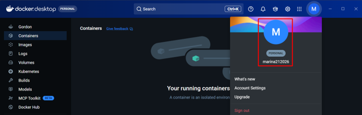
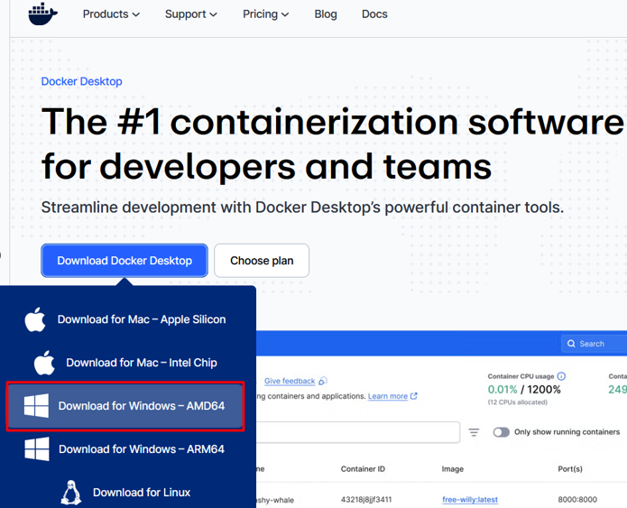
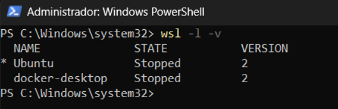
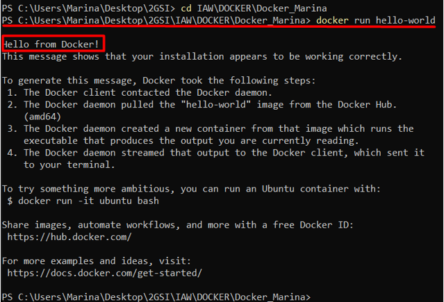
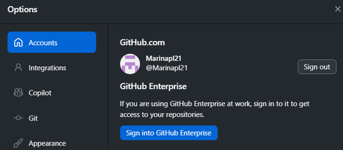

# DOCKER

Guía paso a paso de como descargarnos docker y github

## Autor
- Marina Pérez Lara
- Implantación Aplicaciones Web

---

# Pasos del Proyecto
## Paso 1: Creación de cuenta Docker
Lo inicial, es crearnos una cuenta de Docker, yo lo hice desde el Desktop, pero es lo mismo si nos vamos directamente a la página oficial.

## Paso 2: Instalamos Docker
Aquí, lo único será irnos a la página de docker y buscar el apartado de Docker desktop y haremos click en **"Download docker desktop"**. 
(En nuestro caso escogemos Windows).

## Paso 3: Instalado
Vemos que lo instalamos.

## Paso 4: Status y versión
En este punto usamos la Powershell, ejecutando como administradores o no, y hacemos un **wsl -l -v**. Aqui vemos el status y la versión de Ubuntu y docker-desktop.

## Paso 5: Probar docker
Aquí probamos si docker está efectivamente, funcionando, hacemos un simple **"docker run Hello-world"**.

## Paso 6: Lo reflejado
Después de hacer un docker run, si nos vamos a nuestro docker-desktop, al clickar veremos:

## Paso 7: Github
Finalmente, nos hacemos una cuenta o nos logeamos, la creamos y nos ponemos manos a la obra.

## Conclusiones
- Este es nuestro primer repositorio y pequeño trabajo para Github.
